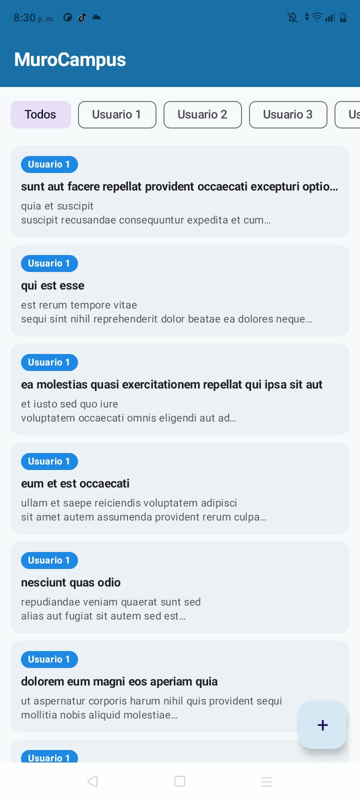
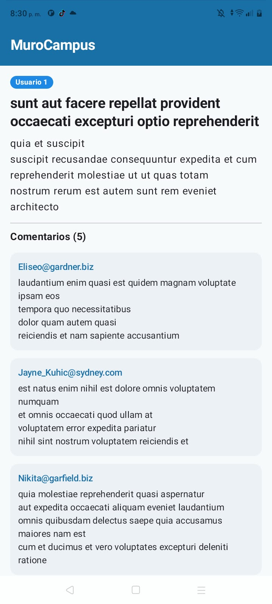
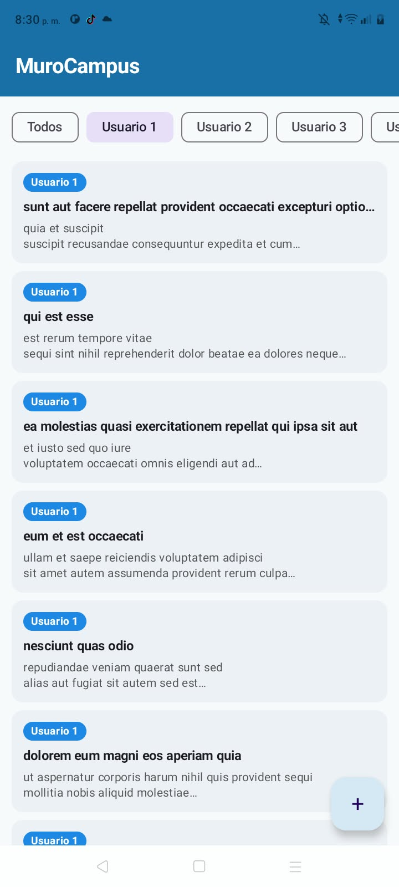
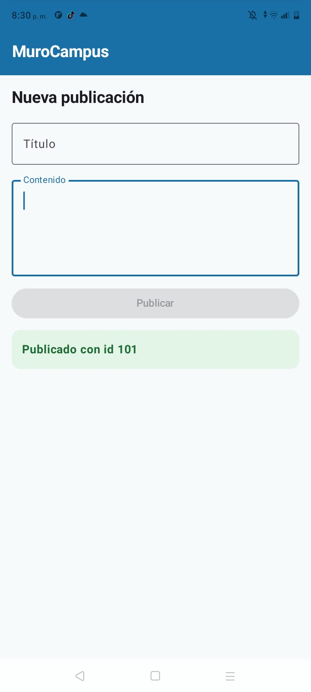

# MuroCampus

**Autor:** Luis Maldonado · Programación en Móviles · 4.º ciclo · Tecsup

App Android (Kotlin + Jetpack Compose) que consume el servicio REST
[JSONPlaceholder](https://jsonplaceholder.typicode.com/): lista publicaciones, muestra el detalle
con sus comentarios, filtra por usuario y crea publicaciones nuevas. Maneja sin cerrarse la falta
de internet, los errores del servidor y las respuestas inesperadas.

## Arquitectura MVVM + Repository

```
 View (ui/)  ──observa StateFlow──▶  PostsViewModel  ──llama──▶  PostRepository (interface)
     ▲                                     │                            │
     └──────── UiState (Cargando /         │                  PostRepositoryRemote
              Exito / Error) ◀─────────────┘                            │ try/catch → Result
                                                                        ▼
                                                     PostApi (Retrofit) ──HTTP──▶ JSONPlaceholder
```

- La pantalla solo dibuja el `UiState` con un `when`.
- El ViewModel convierte `Result` en `UiState`; no conoce Retrofit ni `HttpException`.
- El Repository nunca deja escapar una excepción: devuelve `Result.failure`.

## Estructura de paquetes

```
com.maldonado.murocampus/
├── MainActivity.kt
├── model/
│   └── Modelos.kt              Post, Comentario, NuevoPost (+ Usuario)
├── data/
│   ├── remote/
│   │   ├── PostApi.kt          interface de Retrofit
│   │   └── RetrofitClient.kt   OkHttp + conversor JSON
│   └── PostRepository.kt       interface + PostRepositoryRemote
├── viewmodel/
│   ├── UiState.kt
│   ├── PostsViewModel.kt
│   └── PostsViewModelFactory.kt
└── ui/
    ├── Componentes.kt          TarjetaPost, Cargando, ErrorConReintento
    ├── PantallaLista.kt
    ├── PantallaDetalle.kt
    ├── PantallaCrear.kt
    └── theme/
```

## Capturas

| Lista | Detalle | Filtro | Crear | Sin conexión |
|---|---|---|---|---|
|  |  |  |  |  |

## Para pensar

**1. ¿Qué diferencia hay entre GET y POST? ¿Por qué crear lleva @Body y porUsuario lleva @Query?**
GET solo lee datos y no cambia nada en el servidor; POST envía datos para crear un recurso nuevo.
`crear` manda un objeto completo (título, contenido, usuario), y eso viaja como JSON en el cuerpo:
por eso `@Body`. `porUsuario` solo agrega un filtro a la URL (`posts?userId=2`): por eso `@Query`.

**2. ¿Por qué la ruta es "posts" y no "/posts"?**
Retrofit une la ruta con la URL base. Una ruta que empieza con `/` es absoluta y reemplaza el
camino de la URL base; sin la barra se agrega al final de `https://jsonplaceholder.typicode.com/`.

**3. ¿Por qué el Repository devuelve Result en vez de dejar que la excepción llegue al ViewModel?**
Así el ViewModel no necesita conocer `IOException` ni `HttpException` ni escribir try/catch: recibe
éxito o fallo y lo convierte en `UiState`. Además, si una excepción escapara, la app se cerraría.

**4. ¿Qué pasa si olvidas el permiso INTERNET? ¿Y si olvidas ignoreUnknownKeys y el servidor agrega un campo nuevo?**
Sin el permiso, toda llamada falla con una excepción de seguridad o de red y la app muestra error.
Sin `ignoreUnknownKeys`, un campo que no existe en la data class provoca `SerializationException`
y se muestra "Respuesta inesperada", aunque los datos que sí usamos estén bien.

**5. ¿Por qué la pantalla de lista usa un when sobre UiState y no un if con tres variables?**
Con tres variables (cargando, error, datos) se pueden dar combinaciones imposibles, como cargando
y error a la vez. `UiState` es sellado: siempre hay un solo estado, y el `when` obliga a cubrir
los tres casos o no compila.

**6. JSONPlaceholder no guarda los POST. ¿Cómo cambiaría tu app si usaras un servicio real?**
Después de publicar, la lista debería recargarse (o agregar el post devuelto) para mostrarlo.
También haría falta autenticación (un token en un interceptor), validar los errores 400/401 que
devuelva el servidor y quizá guardar una copia local para trabajar sin internet.
